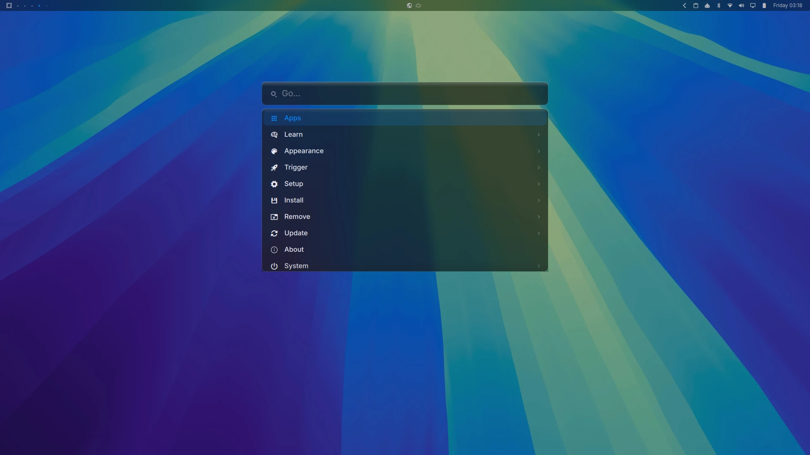

# Sequoia

A macOS Sequoia-inspired theme for [Omarchy](https://omarchy.org/).



## Install

```bash
omarchy theme install https://github.com/adhilroshan/omarchy-sequoia
```

## What's included

- Apple's macOS Sequoia system palette (dark mode) with the default blue accent
- Frosted glassy surfaces, rounded corners, hairline window borders
- Authentic macOS Sequoia wallpapers (Dark + Sunrise forest)
- A matching light variant: [Sequoia Light](https://github.com/adhilroshan/omarchy-sequoia-light)

## Companion light theme

```bash
omarchy theme install https://github.com/adhilroshan/omarchy-sequoia-light
```

## License

MIT
